# Figures

A catalogue of the figures produced by `src/run_pipeline.py` and `src/run_deconvolution.py`, and of
the main figures from `notebooks/publication.ipynb`: what produces each one, what it shows, and how
to read it. Numbers are quoted only where they are printed on the figure or by the code that made it.

## Conventions

- **GSE290585** is the atlas cohort: Illumina MM285, 267 replicates on file, 240 used after
  `EXCLUDED_TISSUES` (Sciatic_Nerve, Optic_Nerve, Mammary_Glands, Thymus). These are merged into
  **20 tissue classes** by `data_loading.MERGE_GROUPS`.
- **GSE196902** is an independent MM285 cohort. It is used only in `notebooks/publication.ipynb`
  and contributes nothing to any atlas or W.
- **Reference / pool split**: 50 / 50 per tissue, seed 42 (`config.DECONV_*`). The reference
  half (116 replicates) builds W *and* selects its probes; the pool half (124) is the only
  GSE290585 material ever mixed.
- **W** is the reference matrix (probes × 20 tissues). NNLS proportions are rescaled to sum to 1,
  so the NNLS residual is the only measure of how well W fits a sample.
- **k** is the number of tissues in a mixture. Where blood is fixed (Scenario A/B,
  `detection_blood_both`), k counts the *non-blood* tissues only.
- **Format and folders.** Only PNG is tracked (`config.FIGURE_FORMAT = "png"`). `src` writes to
  `figures/` and `figures/deconvolution/`; the notebook writes only to `figures/publication/`.

---

## 1. Atlas: `run_pipeline.py`

All 240 GSE290585 replicates. Markers are the top 50 *unique* tissue-specific unmethylated CpG sites
(MM285 probes) per tissue (`MAX_PER_TISSUE = 50`, `REGION_MODE = "unique"`), 1000 markers in total;
each site is a marker for one tissue only.

### `heatmap.png`

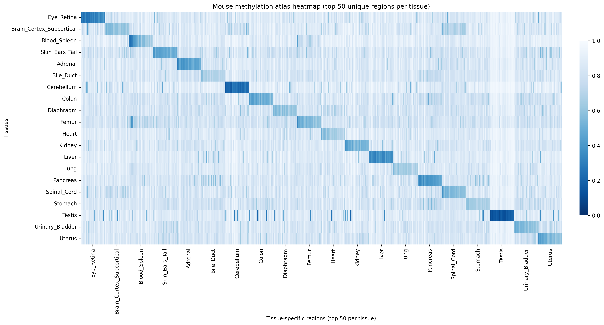

Rows are tissues, columns are markers grouped by the tissue they mark. Each block on the diagonal
is the 50 CpG sites selected for one tissue: sites that are unmethylated in that tissue but
methylated in the others, forming its tissue-specific markers. Dark blue = unmethylated (β ≈ 0),
white = methylated (β ≈ 1), so each tissue's own block is blue and the rest of its row is pale.
Read the **depth** of each block: dark blue (Cerebellum, Testis, Liver, Eye_Retina) means markers
close to fully unmethylated; light blue (Lung, Heart, Diaphragm, Bile_Duct, Stomach)
means markers that are only partly unmethylated, which is a weaker signal downstream.

### `tissue_correlation.png`, `clustered_tissue_correlation.png`, `dendrogram.png`

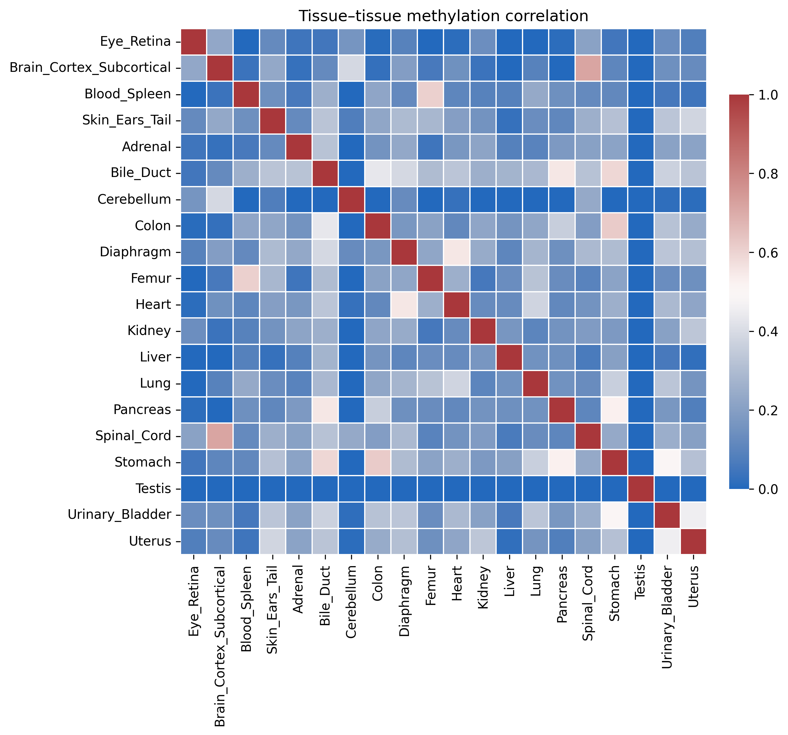
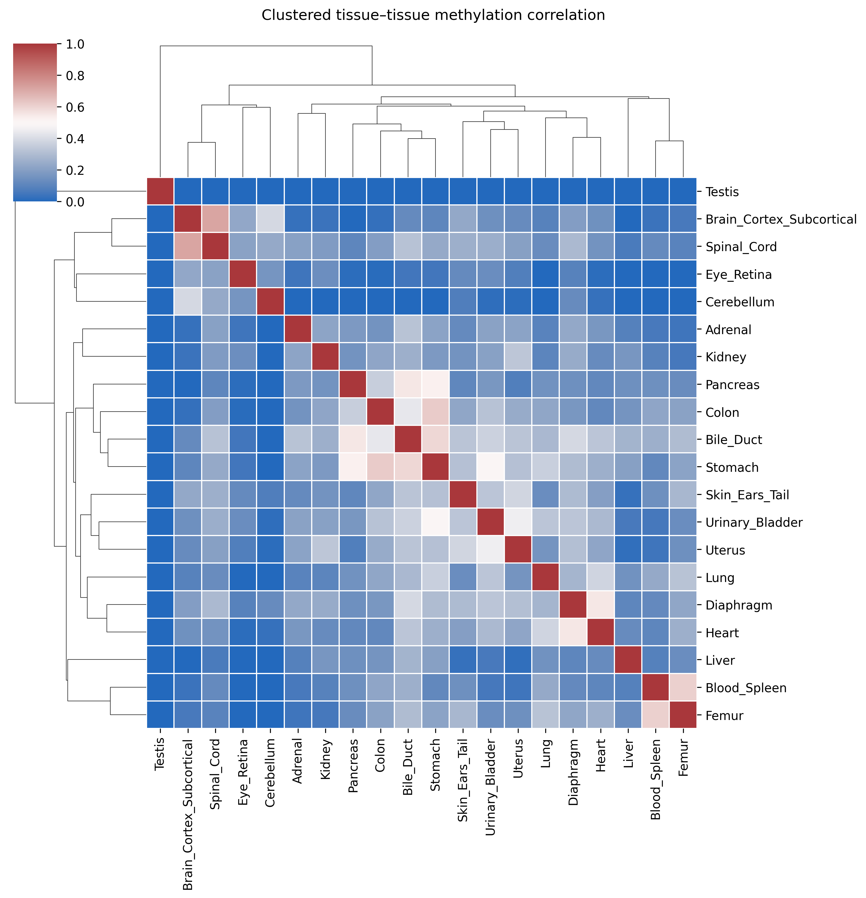
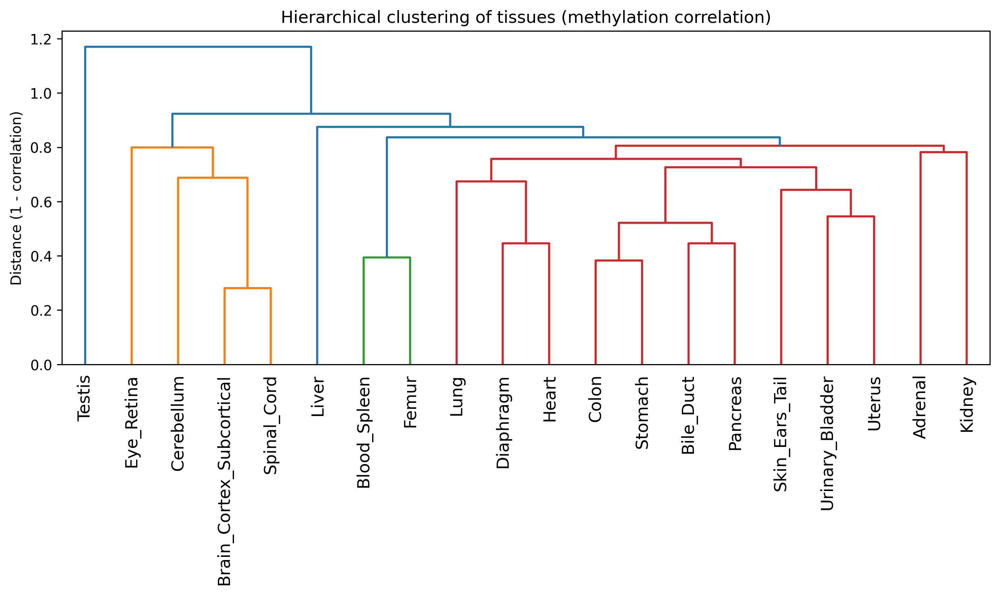

Pearson correlation between tissue profiles over the markers above (blue = low, red = high, scale
0–1).
- `tissue_correlation.png`: the matrix in heatmap order, unclustered.
- `clustered_tissue_correlation.png`: the same matrix as a seaborn clustermap. Its tree uses
  seaborn's default: **Euclidean distance between rows of the correlation matrix**, average
  linkage, not 1 − correlation.
- `dendrogram.png`: hierarchical clustering on **1 − correlation**, average linkage.

The two trees therefore differ in places (Liver joins Blood_Spleen/Femur in the clustermap and
stands alone in the dendrogram); use one of them, not both. Pairs to note because they recur in
every deconvolution result: Blood_Spleen–Femur (r ≈ 0.6), Brain_Cortex_Subcortical–Spinal_Cord,
and the GI group (Colon, Stomach, Bile_Duct, Pancreas).

---

## 2. Deconvolution benchmark: `run_deconvolution.py`

W from the reference half; synthetic mixtures from the pool half. Uterus has too few pool
replicates (minimum 3) and never appears in a mixture, so its panels are empty.

### `deconvolution/reference/`

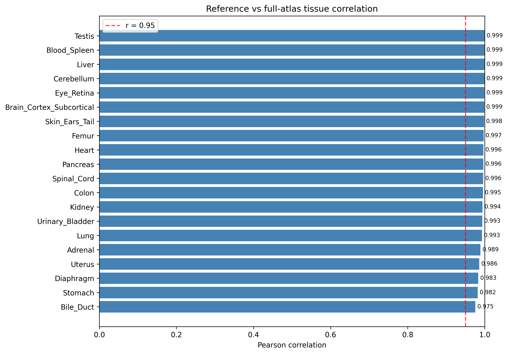

- `reference_heatmap.png`: the reference-half W (116 replicates, 1000 probes) in the atlas
  heatmap layout.
- `reference_atlas_corr.png`: per tissue, Pearson r between the reference-half centroid and the
  full-atlas panel in `top_50_regions_df.csv` (written by `run_pipeline.py`). 0.975 (Bile_Duct) to
  0.999.

### Default run: `python run_deconvolution.py`

1000 balanced mixtures, k = 2–4 tissues, Dirichlet α = 1.

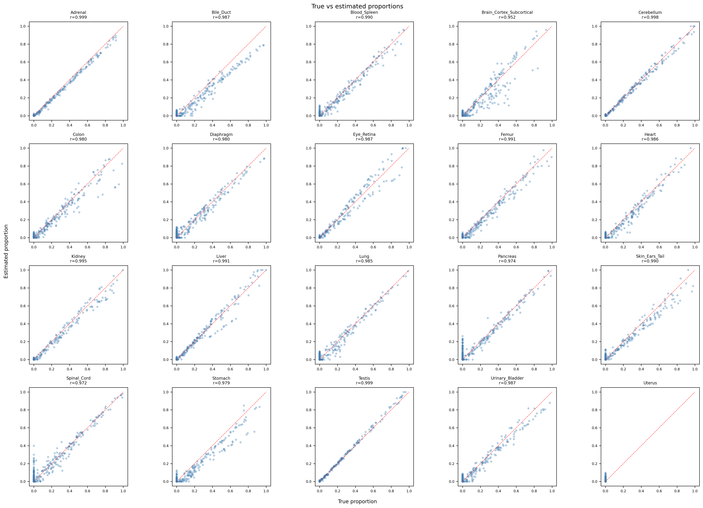

- `deconvolution/eval_scatter_per_tissue.png`: true vs estimated proportion, one panel per
  tissue, Pearson r in each title: 0.952 (Brain_Cortex_Subcortical) to 0.999.

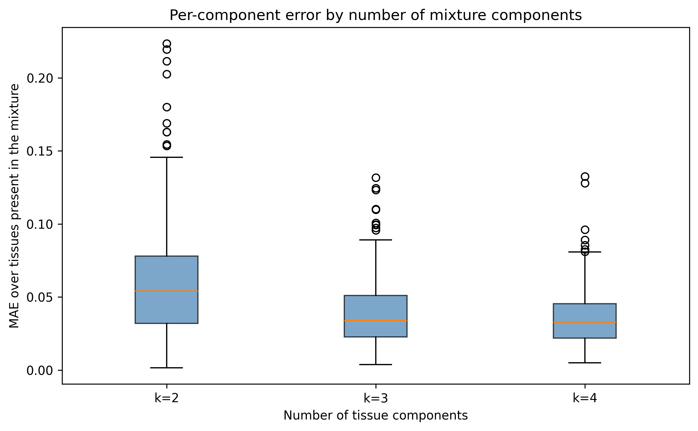

- `deconvolution/eval_mae_by_k.png`: MAE over the tissues **present** in each mixture
  (`mae_present`), by k. It falls with k.
- `deconvolution/eval_per_tissue_mae.png`, `deconvolution/eval_residuals.png`: per-tissue MAE and
  the NNLS residual distribution.

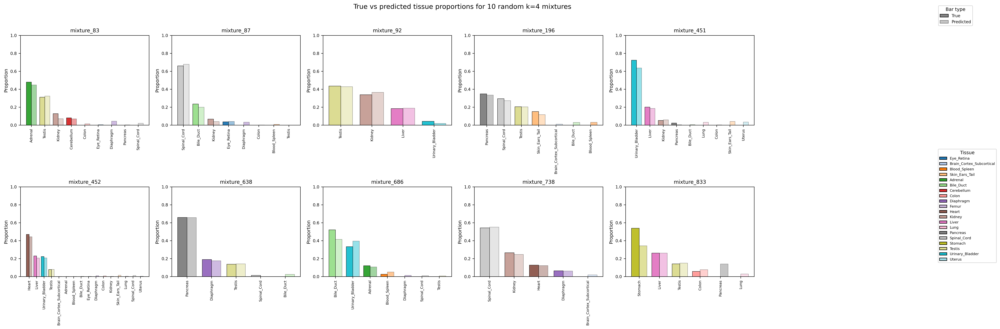

- `deconvolution/mixtures/selected_barplots.png`: ten example mixtures with k = 4, true (dark) vs
  predicted (light) per tissue.
- `deconvolution/mixtures/selected_barplots_log.png`: the same ten panels on a log y-axis from
  10⁻³ (`config.DECONV_BARPLOT_LOG_YMIN`). Bars below the floor, including a true 0 next to a
  non-zero prediction, are not drawn.
- `deconvolution/mixtures/mixture_pca.png`, `deconvolution/mixtures/proportion_dist.png`:
  diagnostics of the generated mixtures: where they sit relative to the W centroids, and how their
  non-zero proportions are distributed.

### cfDNA regimes: `python run_deconvolution.py --regimes suite`

One folder per regime under `deconvolution/mixtures/<regime>/`, each with the same eight figures
as the default run (`eval_scatter_per_tissue`, `eval_mae_by_k`, `eval_per_tissue_mae`,
`eval_residuals`, `selected_barplots`, `selected_barplots_log`, `mixture_pca`, `proportion_dist`).
In the blood-dominant regimes `Blood_Spleen` is always present; the other tissues share the rest
via Dirichlet(α = 0.5).

| Folder | Regime | Blood fraction | Non-blood tissues |
|---|---|---|---|
| `balanced/` | balanced baseline | not forced | 2–4 tissues in total, α = 1 |
| `easy/` | cfDNA easy | 40–60 % | 2–5 |
| `medium/` | cfDNA medium | 60–80 % | 2–5 |
| `hard/` | cfDNA hard | 80–95 % | 2–5 |

The optional `healthy` regime (90–99 % blood, 2 non-blood tissues) is run only when named
explicitly (`--regimes cfdna_healthy`).

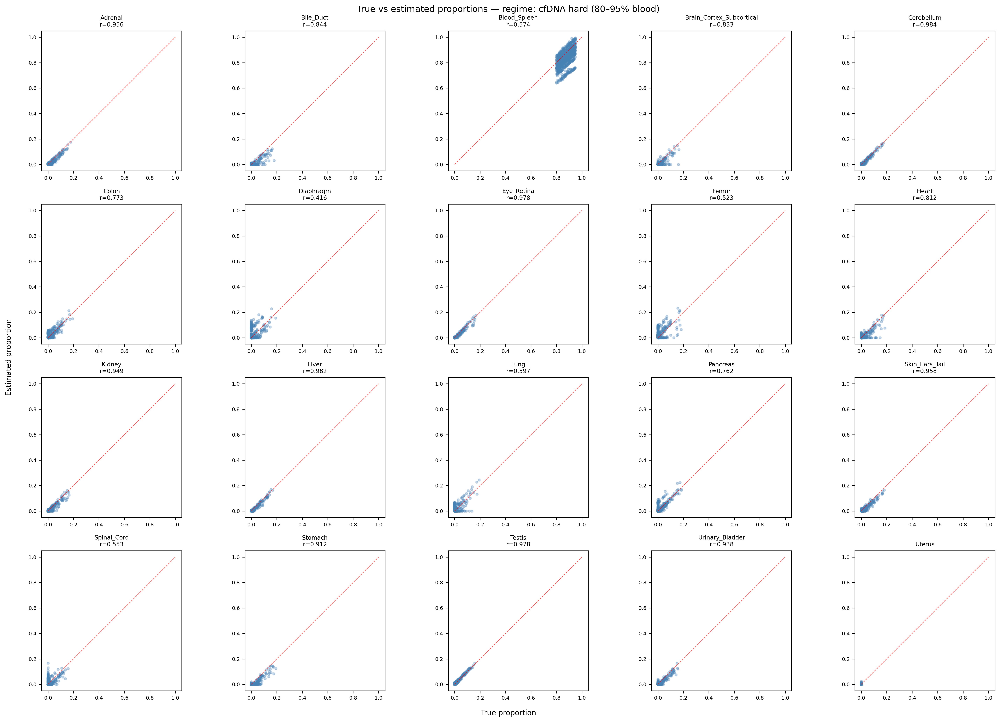

`hard/eval_scatter_per_tissue.png`: with 80–95 % blood, r falls to 0.42 (Diaphragm), 0.52 (Femur),
0.55 (Spinal_Cord), 0.57 (Blood_Spleen) and 0.60 (Lung), while Liver, Cerebellum, Eye_Retina and
Testis stay ≈ 0.98.

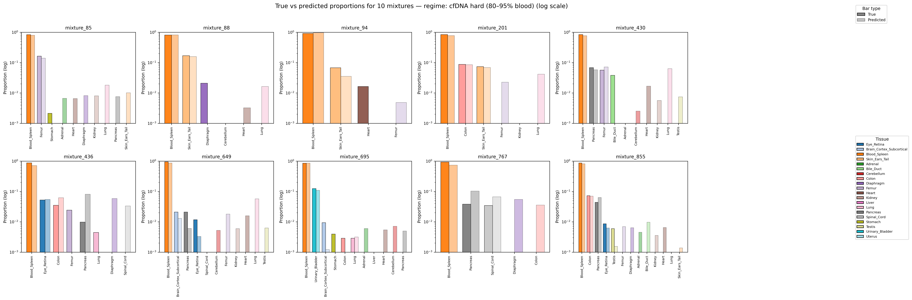

`hard/selected_barplots_log.png`: ten cfDNA-hard mixtures on a log y-axis, so the small non-blood
components next to the dominant blood bar stay readable.

---

## 3. Publication notebook: `notebooks/publication.ipynb`

Written to `figures/publication/` when `SAVE_FIGURES = True` in the notebook's first cell; every
figure is also shown inline. The notebook validates the deconvolution on GSE196902 and produces the
publication figures; the atlas and benchmark figures above come from `src`. Its main figures are
described below. It also writes the GSE196902 mixture figures (`validation/k1…k4_*`,
`validation/mae_by_k`), `tissue_recovery_map` (the map below without the fit-error strip) and
`external_datasets/qc_sample_coverage`.

### Scenario A and B (§II.5): `scenario_A.png`, `scenario_B.png`

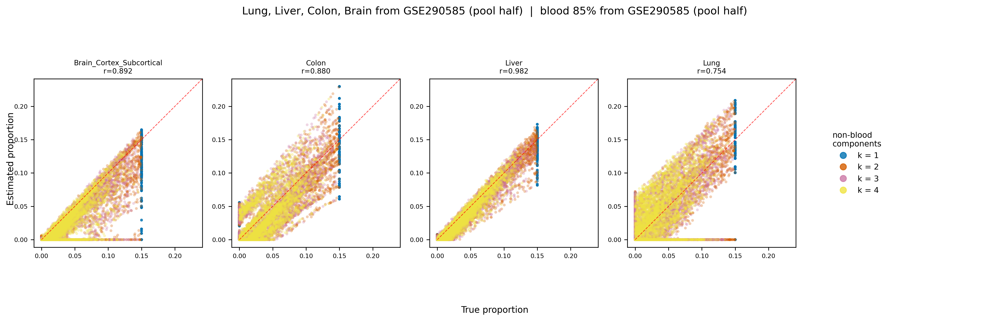
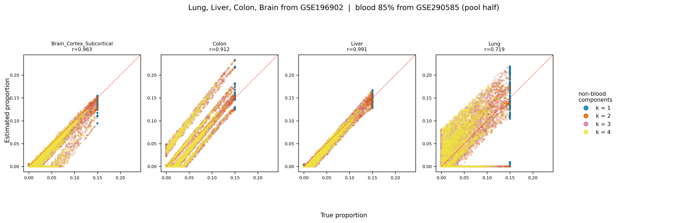

Lung, Liver, Colon and Brain recovered against a fixed **85 % blood** background, k = 1–4 non-blood
tissues, coloured by k. One reference-half W (997 probes shared with GSE196902). A: all tissues
from the GSE290585 pool half. B: the four tissues from GSE196902, blood from the GSE290585 pool
half. The k = 1 points form a vertical stripe at 0.15 by construction. Pearson r: A: Brain 0.89,
Colon 0.88, Liver 0.98, Lung 0.75; B: Brain 0.96, Colon 0.91, Liver 0.99, Lung 0.72.

### One-tissue recovery map with fit error (§II.8): `tissue_recovery_map_fit.png`

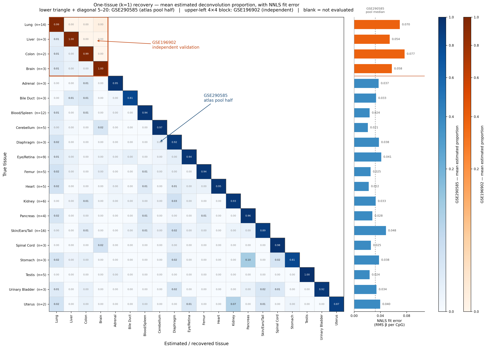

One-tissue (k = 1) recovery as a 20 × 20 map against the same W: row = true tissue, column =
estimated, cell = mean estimated proportion. The lower triangle and diagonal rows 5–20 are
GSE290585 pool samples (blue); the upper-left 4 × 4 block is GSE196902 (orange); blank = not
evaluated. Diagonal: 0.81 (Bile_Duct, Stomach) to 1.00. The strip on the right is the median NNLS
fit error per row (RMS β error per CpG). GSE196902's 0.99–1.00 recovery comes with about twice the
fit error (median 0.062 vs 0.032; 1.3–3.0× on the same four tissues): proportions are rescaled to
sum to 1, so a cohort offset that W cannot fit still lands on one tissue.

### Limit of detection in an 85 % blood background (§I.7): `validation/detection_blood_both.png`

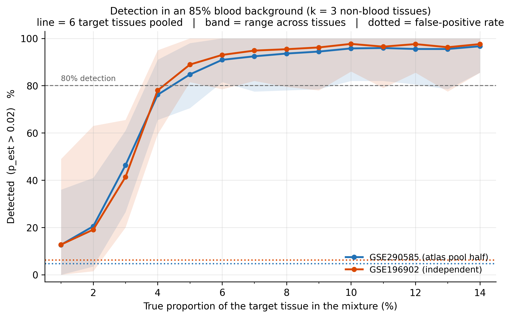

Blood fixed at exactly 85 %, drawn from the GSE290585 pool half for both cohorts (GSE196902 has no
whole blood). One tissue is held at an exact share ("spike", 1–14 %) while the other non-blood
tissues take the rest; each (k, target, level) cell is 200 mixtures. Detection = estimated share
> ε (ε = 0.02). One panel at k = 3 non-blood tissues, one line per cohort (blue GSE290585, orange
GSE196902), band = range across the six targets (Brain, Colon, Liver, Lung, Pancreas, Skin), dotted
= false-positive rate on never-present tissues. **Both cohorts use the same reference-half W and
probe list** (996 probes), so they are directly comparable. Read each curve against its
false-positive floor: detection at or near that floor is not detection.

Limits of detection (≥ 80 % detected), ε = 0.02, range over k = 2–4 (full tables for k = 2–6 are
printed in §I.8):
- **GSE290585**: Liver 3.5–3.7 %, Pancreas 3.6–4.0 %, Colon 4.5–5.2 %, Brain 4.7–5.5 %, Skin
  4.9–5.2 %, Lung 5.8–9.3 %. False-positive floor 4.6–5.0 %.
- **GSE196902**: 3.5–5.1 % for every target. Lung is flagged as a **mass sink** (detected in
  45–56 % of mixtures at a true 1 %), so its 4.0–4.7 % is an artifact and lifts the GSE196902
  curve slightly. False-positive floor 5.7–6.4 %.
- Detection plateaus at about 96–98 %, not 100 %: a few mixtures lose the target entirely.

Blood here is bulk blood from the same cohort and array as W's reference half, which makes this
an optimistic stand-in for real cfDNA.

### cfDNA-hard mixtures (§II.9): `cfdna_hard/`

The `src` cfDNA-hard regime rebuilt 1:1: same split, W, mixtures and barplot selection as
`deconvolution/mixtures/hard/`.

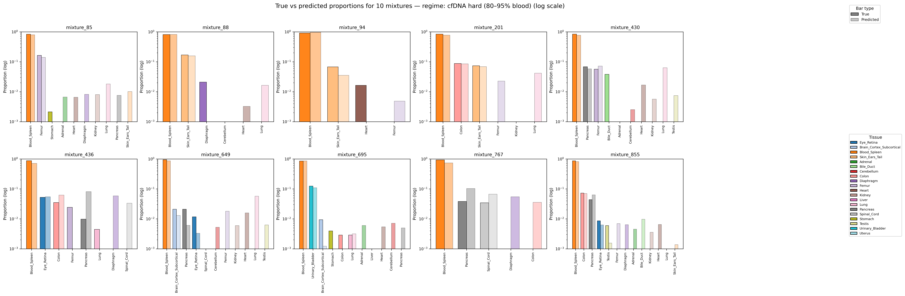

`selected_barplots_log.png`: the ten `hard/selected_barplots` panels on a log y-axis from 10⁻³.

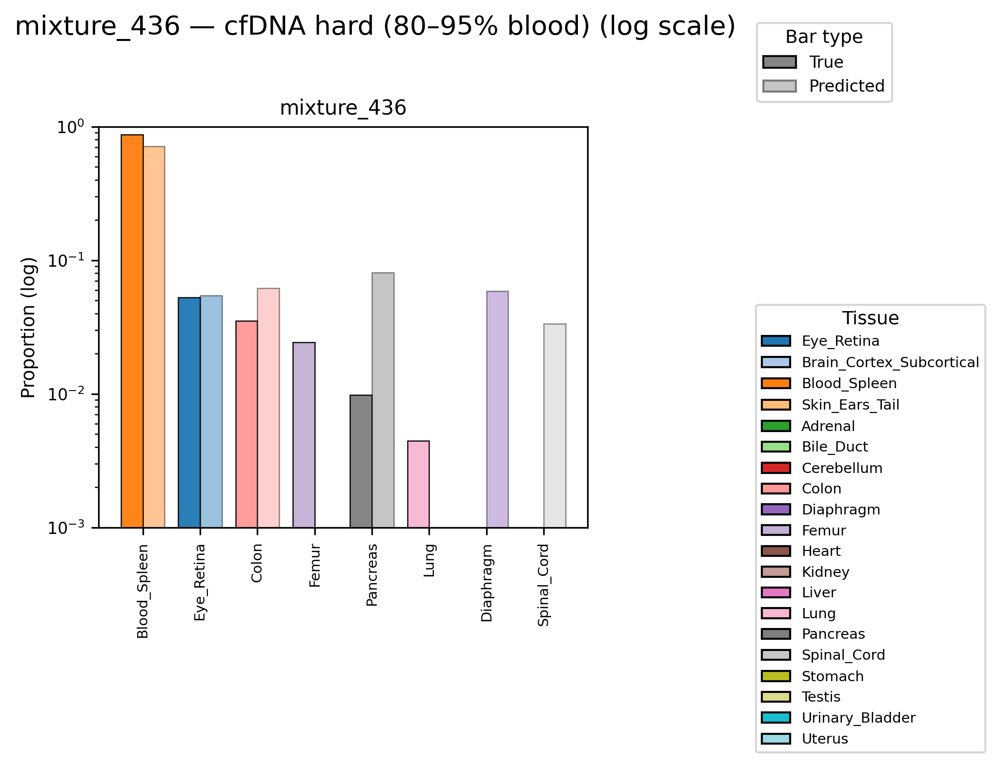
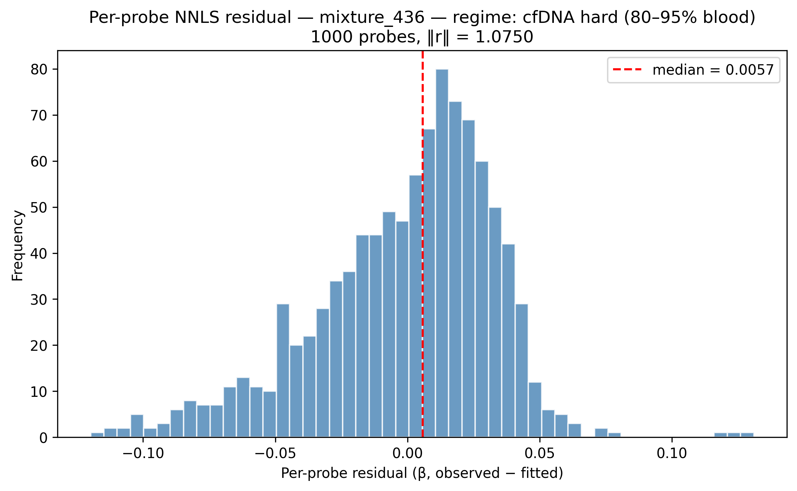
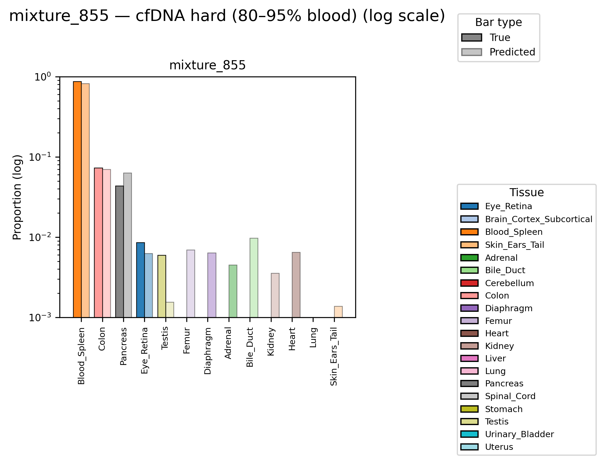
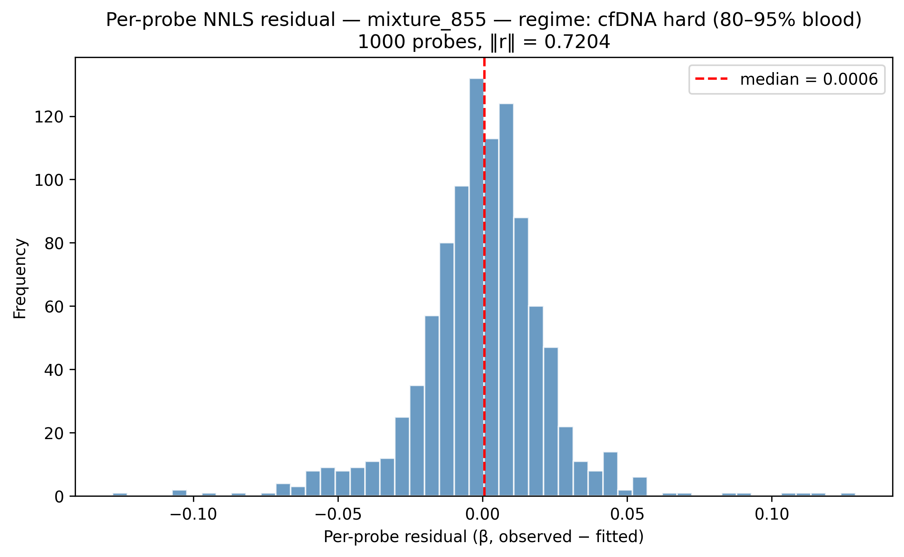

`mixture_436_barplot.png`, `mixture_855_barplot.png`: two of those panels on their own, log
y-axis. `mixture_436_residuals.png`, `mixture_855_residuals.png`: the per-probe NNLS residual
(observed − fitted β) of that mixture; its norm is the mixture's value in `hard/eval_residuals`.

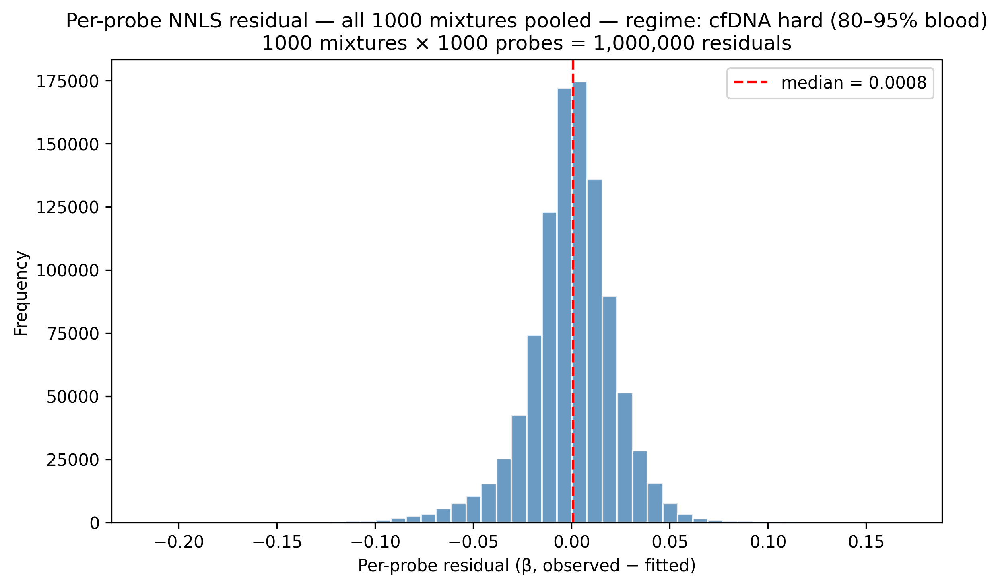

`all_mixtures_residuals.png`: the same per-probe residual pooled over all 1000 cfDNA-hard mixtures
(1000 × 1000 = 10⁶ values). Median +0.0008; 1st–99th percentile −0.071 to +0.053; |r| > 0.1 on
0.37 %.
